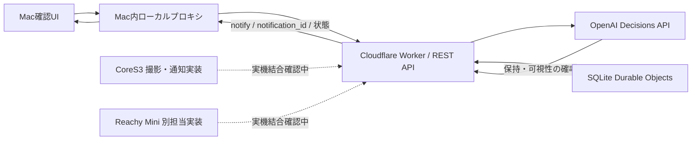

# 集中支援アプリ — スマホを持ったら、作業に戻るきっかけを

作業中についスマホを手に取る人のための、カメラとAIを使った集中支援プロトタイプです。**OpenAI Decisions APIで「スマホを手に持っているか」「手元を判定できるか」を判断し、継続保持を確認したら端末から声かけします。** 本人が開始・一時停止・終了を選べます。集中力やADHDを診断するものではありません。

現在の公開デモ仕様は **2秒保持・通知後のクールダウンなし**。Mac確認UIで画面通知を実演でき、同じ判定APIをCoreS3・Reachy Miniへ展開する構成です。各機器の完成範囲は下表に分けています。

**評価資料:** [評価軸と検証の根拠](docs/evaluation.md) · [提出用説明文](docs/submission.md) · [3分デモ台本・起動手順](docs/demo.md) · [機械可読サマリー](docs/evaluation.json)

## 公開成果物と評価の入口

| 入口 | 確認できる内容 |
| --- | --- |
| [公開API](https://focus-shared-api-20261018.take-otani.workers.dev/) | API入口と仕様書へのリンクを返すJSON。操作画面ではありません |
| [公開仕様書](https://focus-shared-api-20261018.take-otani.workers.dev/docs) / [OpenAPI JSON](https://focus-shared-api-20261018.take-otani.workers.dev/openapi.json) | 認証不要で読めるHTTP契約・状態・判定条件 |
| [health](https://focus-shared-api-20261018.take-otani.workers.dev/health) | 設定状態。資料作成時の応答は `provider: openai, configured: true` |
| [Mac確認UI・最新デモ実装（PR #6）](https://github.com/aieo-product/devdayHackathon261018/pull/6) | カメラ→公開Worker→実OpenAI→画面通知。起動後の画面は `http://127.0.0.1:3000` |
| [公開リポジトリ](https://github.com/aieo-product/devdayHackathon261018) | ソース、テスト、資料、進捗 |

認証不要の資料閲覧と、認証が必要な画像判定APIは別です。`/v1/*`にはチームから受け取るアプリトークンが必要です。**公開された操作用Web UIのURLは未確認**で、localhostのMac確認UIは第三者がそのままアクセスできる提出URLにはなりません。`health`だけで画像認識の成功や精度を証明することもできません。

> **バージョンの注意（2026-10-18時点）:** 公開WorkerとPR #6は2秒保持・待機0秒ですが、この資料の検証元 `feat/shared-focus-api` / `4ca4368` のコードは5秒保持・待機60秒です。PR #6は確認時点で未マージです。このブランチのローカル実行と公開デモを同じ版として評価しないでください。[比較と根拠](docs/evaluation.md)を参照してください。

## 解決したいことと利用体験

勉強やデスクワークで、気付かないうちにスマホへ手が伸びることがあります。本アプリは、その行動を本人が気付くきっかけに変えます。

1. 利用者が監視を開始し、カメラに手元を映します。
2. AIが画像ごとにスマホ保持と可視性を判定します。机上に置かれただけのスマホは対象外です。
3. APIが新しい画像で2秒以上の保持を確認したら、`notify: true`と一意の通知IDを返します。
4. 端末が画面・音・動きに変換します。必要なスマホ作業中は一時停止できます。

2秒は画像の受理時刻に基づく確認済み時間です。撮影・通信・推論の遅延があり、実際に持った瞬間から正確に2.000秒で通知する保証ではありません。判定不能時は通知せず、停止後に遅れて戻った結果も通知しません。

## 審査4観点と成果の対応

[公式イベントページ](https://luma.com/OpenAIDevDay2026CommunityHackathonTokyo)の4観点に沿った説明です。検証可能な成果と、今後検証する価値を分けて示します。

| 観点 | 提案・実装 | 評価できる根拠 |
| --- | --- | --- |
| 新機能の活用 | Decisions APIの2つのpredicateを、画像からの保持判定と可視性判定に使用 | [provider実装](api/src/provider.mjs)、[実API試験記録](https://github.com/aieo-product/devdayHackathon261018/issues/3) |
| 使いやすさ | 開始・一時停止・終了、保持時間と判定理由の表示、停止時のカメラ停止 | [Mac確認UIの実装・試験](https://github.com/aieo-product/devdayHackathon261018/pull/6)、[クライアントの停止テスト](clients/focus-client.test.mjs) |
| 有用性 | 作業からスマホへ注意が移ったとき、本人へ復帰のきっかけを提供 | [利用シナリオとデモ](docs/demo.md)。集中時間の改善・継続利用効果は未測定 |
| 独創性 | 共通のAI判断を、PCの画面通知・小型端末の音・ロボットの反応へ接続する設計 | [API契約](docs/api-contract.md)、[CoreS3実装](devices/cores3/cores3.ino)、[Reachy担当記録](https://github.com/aieo-product/devdayHackathon261018/issues/2)。機器ごとの結合範囲は下表 |

## 現在の完成範囲

確認日: **2026-10-18（JST）**。本チャットでの再実行、担当セッション・PRの報告、未確認を区別しています。

| 機能 | 状態 | 根拠・範囲 |
| --- | --- | --- |
| 共通API・状態管理・停止・重複抑止 | 実装・ローカル検証済み | この版の `npm test` **31/31**、Worker結合 **1/1**、mockスモーク成功 |
| Cloudflare公開・実Decisions判定 | 公開済み、実推論の担当検証あり | 今回health/公開仕様書をGET確認。写真判定は[Issue #3](https://github.com/aieo-product/devdayHackathon261018/issues/3)の有限試験 |
| 2秒保持・繰り返し通知・Mac確認UI | PR #6に実装、公開Worker反映の記録あり | 担当報告: 仮想カメラから実APIへ送り、保持2534ms・2386msで2回通知。画面内通知・ビープを実装、OS通知は未実装 |
| CoreS3 | ビルド・USB書込み・停止起動を確認 | [実機記録](devices/cores3/README.md)。実画像→通知音の一連動作は未確認、担当セッションで継続中 |
| Reachy Mini Wireless | 別担当の実装・部分確認の報告あり | [Issue #2](https://github.com/aieo-product/devdayHackathon261018/issues/2)。インストール・カメラ表示等。実画像→fear1反応、音・動作、Macなし継続は未確認。このチェックアウトに実装コードなし |
| MCP Events・dots・遠隔ON/OFF | 開発中 | [Issue #7](https://github.com/aieo-product/devdayHackathon261018/issues/7)とWeb担当セッション。接続完了・配信成功として扱わない |
| 公開操作UI・提出受付 | 未確認 | 公開API URLとlocalhost UIを区別。提出前の確認項目は[提出資料](docs/submission.md) |

## 構成とAIの役割



AIへの問い合わせは `gpt-6-luna`、`observable`と`phone_use`の2 predicateです。確率を受けた共通エンジンが、しきい値・継続時間・重複・停止を判断します。端末は新しいフレーム応答の`notify: true`を一度だけ実行します。

公開Workerはセッション状態と受理済みフレームIDをSQLite Durable Objectsへ保存します。ローカルNode APIはプロセスメモリを使い、再起動で状態が失われます。

## APIキー・カメラ不要の最短検証

Node.js **22.9以上**（今回の検証は24.19.0）。リポジトリ直下で実行します。Node APIと以下のテストは外部npm依存不要です。

```sh
npm test
```

端末Aで、`.env`を読み込まずモックを明示して起動します。以下のトークンはローカル試験専用の例です。

```sh
env -u OPENAI_API_KEY \
  DECISION_PROVIDER=mock FOCUS_API_TOKEN=local-evaluation-token \
  MOCK_PHONE_PROBABILITY=0.95 MOCK_OBSERVABLE_PROBABILITY=1 \
  HOST=127.0.0.1 PORT=18787 \
  node api/src/index.mjs
```

端末B:

```sh
FOCUS_API_URL=http://127.0.0.1:18787 \
FOCUS_API_TOKEN=local-evaluation-token \
node scripts/smoke-test.mjs --expect-notify
```

このチェックアウトでは、合成画像を使い約5秒の保持で通知1回→重複抑止→一時停止→再開→終了を検証します。成功時は`PASS`、終了コード0です。mockは画像を解析しないため、認識精度や公開デモの2秒判定の試験にはなりません。終了後は端末AをCtrl+Cで停止します。

Workerのローカル結合試験には開発依存が必要です。実OpenAIへの画像送信はしません。

```sh
npm ci
npm run test:worker
```

最新の2秒デモは[PR #6の固定コミットと起動手順](docs/demo.md)で再現します。このブランチには`start:mac-check`がないため、そのコマンドだけを実行しても起動しません。

## データと現在の制約

- 実APIモードでは画像をCloudflare経由でOpenAIへ送ります。アプリ側で生画像を永続保存する処理はありません。外部サービスの保存方針まで「保存されない」と保証するものではありません。
- `OPENAI_API_KEY`はサーバーだけに設定します。`FOCUS_API_TOKEN`は別のデモ用共有トークンです。Mac確認UIはローカルプロキシがこのトークンを保持します。利用者別の認証・権限分離は未実装です。
- 机上か手持ちかを判定しますが、スマホを使う目的は判定しません。必要な利用には一時停止を使います。
- 観測間隔が2.5秒を超えると保持時間をリセットします。認識精度の統計評価、実環境の遅延分布、集中への効果は未測定です。

## 開発者向け資料

- [Node APIのセットアップ](api/README.md) / [このチェックアウトのHTTP契約](docs/api-contract.md)
- [Workerのセットアップ](cloudflare/README.md) / [このチェックアウトのAPI仕様書](cloudflare/API仕様書.md)
- [CoreS3のセットアップと実機記録](devices/cores3/README.md)
- [全体進捗 #1](https://github.com/aieo-product/devdayHackathon261018/issues/1) / [Reachy #2](https://github.com/aieo-product/devdayHackathon261018/issues/2) / [API #3](https://github.com/aieo-product/devdayHackathon261018/issues/3) / [拡張 #7](https://github.com/aieo-product/devdayHackathon261018/issues/7)
